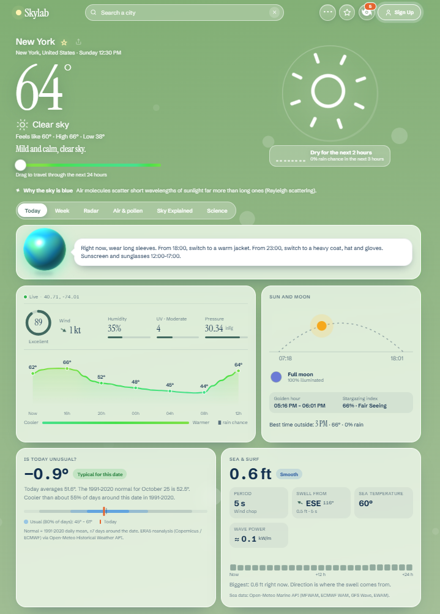
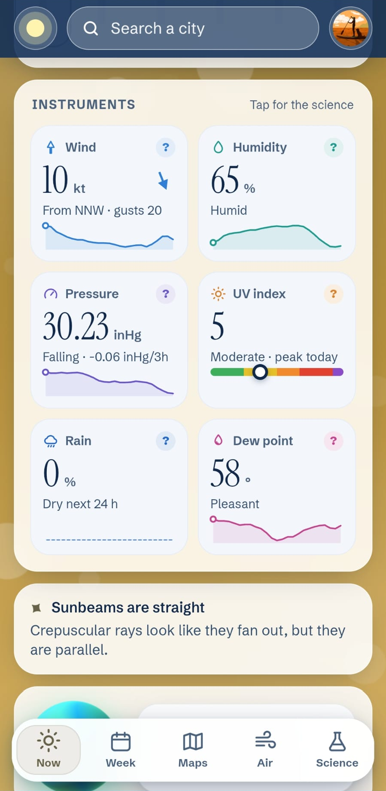
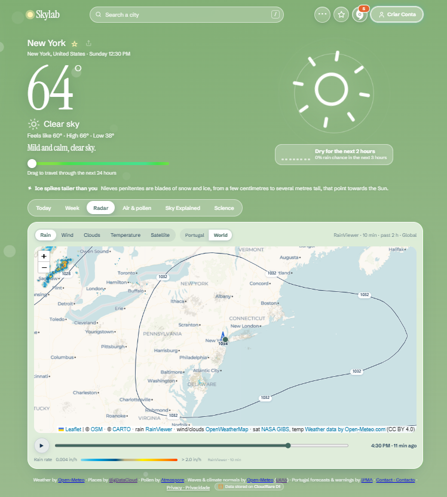
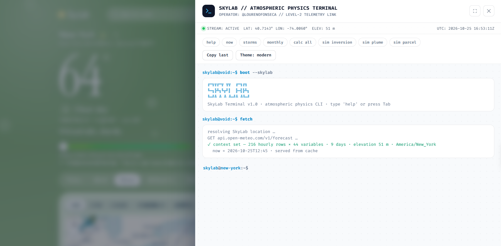
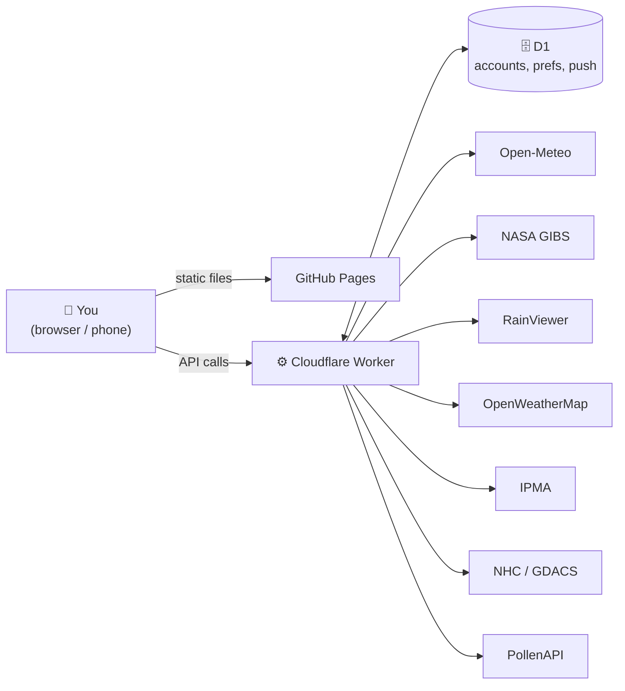

<div align="center">


# SkyLab

### *The sky, explained to you.*

Not just *the* weather. The whole science behind it. 🔬

<br>

[](https://loripori.github.io/SkyLab/)

<br>


<br>


</div>

---

## 📑 Table of contents

- [🌤️ About](#️-about)
- [💡 Why I built it](#-why-i-built-it)
- [✨ Features](#-features)
- [📸 Screenshots](#-screenshots)
- [💻 SkyLab Terminal](#-skylab-terminal)
- [🧱 Tech stack](#-tech-stack)
- [🗺️ How it works](#️-how-it-works)
- [📁 Project structure](#-project-structure)
- [🚀 Run it locally](#-run-it-locally)
- [🛰️ Data sources and credits](#️-data-sources-and-credits)
- [🔐 Privacy and security](#-privacy-and-security)
- [🧭 Roadmap](#-roadmap)
- [🤝 Contributing](#-contributing)
- [📜 License](#-license)
- [👋 About me](#-about-me)
- [📬 Contact](#-contact)

---

## 🌤️ About

SkyLab is a weather project that informs you about the current weather and the **science behind it**. And it's incredibly fun! 🎉

Whether you're a regular citizen, a very dedicated student, or just a weather enthusiast, SkyLab fits you. It fetches high-quality data from open platforms like OpenWeatherMap and RainViewer, and puts it all in one place.

> [!NOTE]
> This app was built entirely with **free tools** and with the help of **Claude**, as I'm not an experienced coder. The framework, the backend, and the databases, though, were all designed and coordinated by me, the proud developer of what I believe is a good weather app. 

Feel free to explore it. SkyLab has a whole world of features worth discovering, so don't forget to read the rest! 👇

## 💡 Why I built it

A couple of months ago, I opened my phone's built-in weather app. I checked the current weather, the next few hours, and decided what to wear for the day. Simple enough.

But the data was shallow. Little to no complex information, like **pressure variation**, was included. Then it hit me: I recognised an annoying pattern in *every single* weather app. They were all **too shallow**. 

SkyLab is the solution I found. By combining many kinds of data and patterns, it suits everyone: an all-in-one tool built for your daily needs. With SkyLab, you don't just see the weather; you actually **get informed** about it.

> 🧪 **One app, many tools.** Check out the features!

## Features

<table>
<tr>
<td width="50%" valign="top">

### 🗺️ Maps and radars
- 🌧️ Global rain radar, provided by [RainViewer](https://www.rainviewer.com/)
- ☁️ Cloud, wind, temperature with real-time isobars
- 🛰️ Satellite view by [NASA](https://www.earthdata.nasa.gov/engage/open-data-services-software/earthdata-developer-portal/gibs-api)


</td>
<td width="50%" valign="top">

### 🔬 Forecast and science
- 🕐 Hourly, weekly, and monthly forecasts
- 🌼 Detailed pollen data
- 📖 A pattern-based tool that tells you why the weather is like it is
- 🧠 Daily science facts and a *Myth or Fact* game

</td>
</tr>
<tr>
<td width="50%" valign="top">

### 👤 Your account *(optional sign-in)*
- ⭐ Favourite cities synced between devices
- 🔔 Weather push notifications for your main city
- ⌨️ Built-in terminal to analyse raw weather data. Check out the [Terminal](#-skylab-terminal)
- 🗑️ Account deletion at any time

</td>
<td width="50%" valign="top">

### 🎁 Extras
- 🌐 Portuguese / English, with units that follow the language
- 👕 Clothing advisor orb (be careful with him!)

</td>
</tr>
</table>

### And much more!

## 📸 Screenshots

| 🖥️ Desktop | 📱 Mobile |
|:---:|:---:|
|  |  |
| **🌧️ Radar** | **💻 Terminal** |
|  |  |

## 💻 SkyLab Terminal

A command line built into the app, for people who want **raw atmospheric data**. 🤓

```text
fetch -loc "Lisbon"          # current conditions
calc dew_point               # atmospheric physics helpers
compare -loc1 Lisbon -loc2 Oymyakon
plot --var temperature       # ASCII sparkline
export --format csv          # also: cpp_struct
```

<details>
<summary><b>📖 Full command list (click to expand)</b></summary>

<br>

*Write here: every command, one per line, with a short description.*

</details>

## 🧱 Tech stack

| Layer | What I used |
|---|---|
| 🎨 Front end | HTML, CSS and JavaScript, no frameworks |
| ⚙️ Back end | Cloudflare Worker + D1 (SQLite) |
| 🌐 Hosting | GitHub Pages (front end), Cloudflare (worker) |
| 🔔 Notifications | Web Push (VAPID) |
| 🔑 Sign-in | Email code verification + Google |

## 🗺️ How it works



The worker sits between the app and every data provider. That keeps API keys private, caches responses, and protects the free quotas.

## 📁 Project structure

```text
SkyLab/
├── 📄 index.html      # page structure
├── 🎨 styles.css      # all styling
├── 🧠 app.js          # all front-end logic
├── 🔔 sw.js           # service worker (push notifications)
├── ⚙️ worker.js       # Cloudflare Worker (API, auth, proxies)
├── 🖼️ icon-web.png
└── 📸 screenshots/
```

## 🚀 Run it locally

1. 📥 Clone the repository:
   ```bash
   git clone https://github.com/loripori/SkyLab.git
   cd SkyLab
   ```
2. 🖥️ Serve the folder with any static server:
   ```bash
   python -m http.server 8000
   ```
3. 🌍 Open `http://localhost:8000`.

> [!IMPORTANT]
> The worker needs its own setup (Cloudflare account, D1 database, secrets).
> *Write here: link to a SETUP.md, or list the environment variables.*

## 🛰️ Data sources and credits

SkyLab stands on the shoulders of these open services. Thank you! 🙏

| | Source | Used for |
|:-:|---|---|
| 🛰️ | [NASA GIBS / IMERG](https://earthdata.nasa.gov/gibs) | Precipitation and satellite imagery |
| 🌡️ | [Open-Meteo](https://open-meteo.com/) | Forecasts and current conditions |
| 🌧️ | [RainViewer](https://www.rainviewer.com/) | Radar tiles |
| ☁️ | [OpenWeatherMap](https://openweathermap.org/) | Cloud, wind and temperature tiles |
| ⚠️ | [IPMA](https://www.ipma.pt/) | Portuguese weather warnings |
| 🌀 | [NHC](https://www.nhc.noaa.gov/) and [GDACS](https://www.gdacs.org/) | Tropical storms |
| 🌼 | [Atmospore / PollenAPI](https://pollenapi.com/) | Pollen data |

## 🔐 Privacy and security

*Write here: what data is stored (email, Google ID, location), what is not, how to delete an account, and where the full privacy page is.*

> [!WARNING]
> Found a vulnerability? Please email the address in [Contact](#-contact) instead of opening a public issue.

## 🧭 Roadmap

- [x] 🌧️ Radars, forecast, accounts, push notifications
- [x] 💻 Terminal with real commands
- [ ] 💭 *Next idea*
- [ ] 💭 *Another idea*

## 🤝 Contributing

SkyLab is a personal project, and I'm **not accepting code contributions** (pull requests). Any PR will be closed without review. 🙅

- 🐛 Found a bug? Open an **issue** and tell me what happened.
- 💡 Have an idea? Open an **issue** too, I'm happy to read it.
- 🍴 Want to experiment? You can fork it, within the terms of the [license](#-license).

## 📜 License

Released under the **MIT License**. See the [`LICENSE`](LICENSE) file for details.

> [!NOTE]
> The license covers SkyLab's own code. The data comes from the third-party services listed in [credits](#️-data-sources-and-credits), and each has its own terms.

## 👋 About me

*Write here: who you are, in your own words. Where you're from, what you do, what else you build.*

## 📬 Contact

| | |
|:-:|---|
| 📧 | [skylab.support@gmail.com](mailto:skylab.support@gmail.com) |
| 🐙 | [@loripori](https://github.com/loripori) |

---

<div align="center">

<sub>Made with ☕ and curiosity in Lisbon 🇵🇹<br>If SkyLab helped you understand the sky a bit better, a ⭐ on the repo is the best thank-you.</sub>

</div>
